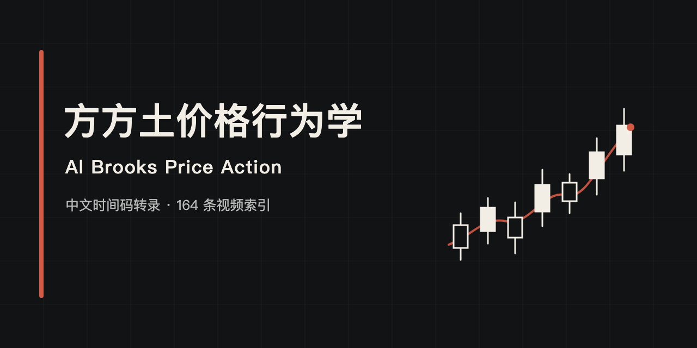

# 方方土价格行为学中文转录｜Al Brooks Price Action 学习目录



这是一个面向学习和检索的公开视频中文转录资料库，整理**方方土 PriceAction** 等公开来源中与 **Al Brooks、Price Action（价格行为交易）**相关的视频。

目前收录 **164 条视频记录**：**163 份完整、带时间码并已校对的中文转录稿**，以及 **1 条无法公开访问的索引记录**。内容来自 YouTube 和 Bilibili；每个可访问视频都保留原视频链接，并且只保存一份规范转录稿。

> 本仓库不是 Al Brooks、方方土 PriceAction、其他视频作者或平台的官方项目，也不收录付费课程、书籍扫描件、视频或音频文件。

## 快速入口

| 你想做什么 | 入口 |
|---|---|
| 按由浅入深的顺序学习 | [方方土价格行为学学习目录](学习目录.md) |
| 浏览 YouTube 中文时间码转录 | [YouTube 转录目录](transcripts/youtube) |
| 浏览 Bilibili 中文时间码转录 | [Bilibili 转录目录](transcripts/bilibili) |
| 查询“原视频 → 转录稿 → 学习分类” | [CSV 视频索引](metadata/index.csv) · [JSON 视频索引](metadata/index.json) |
| 查看公开来源 | [来源清单](metadata/sources.json) |
| 报告错字或时间码问题 | [勘误与贡献说明](CONTRIBUTING.md) |

也可以使用 GitHub 仓库搜索，按视频标题、视频 ID 或术语查找转录内容，例如 `Market Cycle`、`Measured Move`、`信号 K 线`、`突破`、`止损`。

## 收录内容

| 来源 | 视频记录 | 完整转录 | 无法公开访问 |
|---|---:|---:|---:|
| YouTube | 157 | 156 | 1 |
| Bilibili | 7 | 7 | 0 |
| **合计** | **164** | **163** | **1** |

学习目录按主题分为七章：

1. 入门必看
2. 读图基础、信号 K 线与复盘
3. 市场结构、市场周期、突破、楔形与反转
4. 止损、仓位、早盘策略与交易管理
5. 交易心理、职业路径与长期纪律
6. 实盘讲解与复盘案例
7. 期权与补充资料

这套资料适合希望系统学习 Al Brooks 价格行为学、裸 K 线分析、日内交易复盘和风险管理的中文读者。转录稿用于定位原视频内容和复习术语，不能替代对原视频、图表和上下文的完整观看。

## 数据如何整理

每条索引记录包含平台、作者、视频 ID、标题、学习分类、顺序、时长、原视频链接、转录路径、转录来源和校对状态。整理流程如下：

1. 从公开页面核对视频记录和原视频链接。
2. 优先使用公开字幕；没有字幕时，再对公开视频音轨进行语音转录。
3. 保留时间码，按上下文校正常见术语和明显识别错误。
4. 按视频 ID 去重；分类和学习顺序只写入索引与学习目录，不复制转录稿。
5. 检查数量、映射、时间码、本地链接、重复文件、大文件和常见敏感信息。

“已校对”表示完成了逐行语义检查，不代表转录能够替代原视频，也不保证每个口语停顿、语气词或专有名词都与原音逐字一致。如发现问题，请按[勘误格式](CONTRIBUTING.md#提交转录勘误)提供视频 ID 和时间码。

## 数据结构与复现

```text
.
├── README.md
├── 学习目录.md
├── CITATION.cff
├── NOTICE.md
├── CONTRIBUTING.md
├── assets/
│   ├── social-preview.svg
│   └── social-preview.png
├── transcripts/
│   ├── youtube/      # 156 份
│   └── bilibili/     # 7 份
├── metadata/
│   ├── index.csv     # 164 条记录
│   ├── index.json    # 164 条记录
│   └── sources.json  # 公开来源清单
└── scripts/
    ├── check_new_videos.py
    ├── render_catalog.py
    └── verify_repository.py
```

检查仓库结构和内容：

```bash
python3 scripts/verify_repository.py
```

检查公开来源是否出现新视频：

```bash
python3 scripts/check_new_videos.py
```

更新 JSON 索引后，重新生成 CSV 和学习目录：

```bash
python3 scripts/render_catalog.py
```

更新检查只读取公开来源，不使用浏览器 Cookie 或登录状态。如果平台暂时拒绝公开请求，脚本会报告错误，不会把请求失败误判为“没有更新”。

## 常见问题

### 这是 Al Brooks 或方方土的官方仓库吗？

不是。这是独立整理的学习索引和中文转录资料库。原视频作者、来源平台及版权边界均在转录头部、索引和[版权与来源说明](NOTICE.md)中标明。

### 这里包含 Al Brooks 的付费课程或书籍吗？

不包含。本仓库只整理索引中列明的公开视频，不提供付费课程、书籍扫描件、原始视频或音频下载。

### 如何找到某一期视频的转录？

优先使用[学习目录](学习目录.md)按主题浏览；已知标题、视频 ID 或术语时，可以使用 GitHub 仓库搜索，或查询 [CSV](metadata/index.csv) / [JSON](metadata/index.json) 索引。

### 可以引用这个资料库吗？

可以使用仓库根目录的 [`CITATION.cff`](CITATION.cff) 生成仓库引用。引用仓库不改变原视频及原始内容的版权归属。

### 这些内容构成投资建议吗？

不构成。本仓库只用于学习、检索和复盘，不推荐任何证券、期货、期权、外汇或加密资产，也不承诺收益。

## English summary

This repository provides Chinese, timecoded transcripts and a structured learning index for public videos related to Al Brooks and price action trading, primarily from Fangfangtu PriceAction, with YouTube and Bilibili sources. It currently indexes 164 videos, including 163 proofread transcripts and one unavailable record. This is an unofficial study archive and does not contain paid courses, books, video, or audio files.

## 版权与交易风险

视频、音频、字幕及原始表达的版权归原作者和相关平台所有。本仓库仅提供学习整理、检索映射和勘误维护，不对原始内容主张重新授权。详细边界见[版权与来源说明](NOTICE.md)。

本仓库内容不构成投资建议。交易可能造成重大损失，请独立判断，并根据自身情况严格控制风险。
